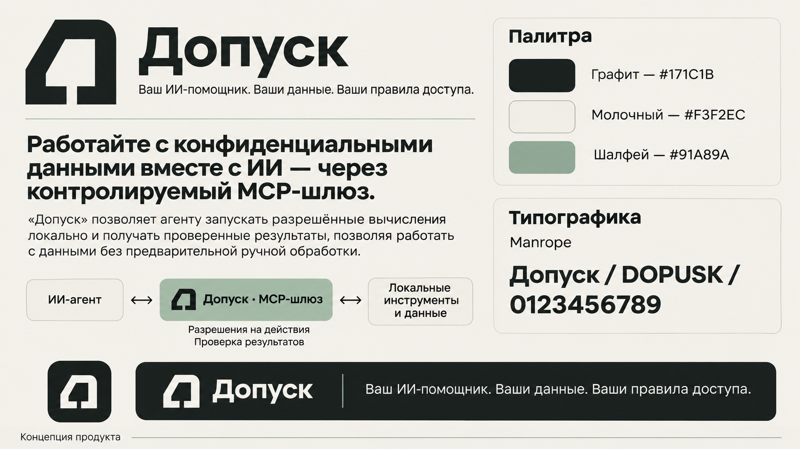

# Практика №1 · Товарный знак и брендирование

Бренд-лист «Допуска»: минималистичная айдентика с акцентом на приватность и контролируемый доступ ИИ к данным через MCP-шлюз.

[Открыть изображение в полном размере](brand-board.png) · [Все практики](../README.md)
